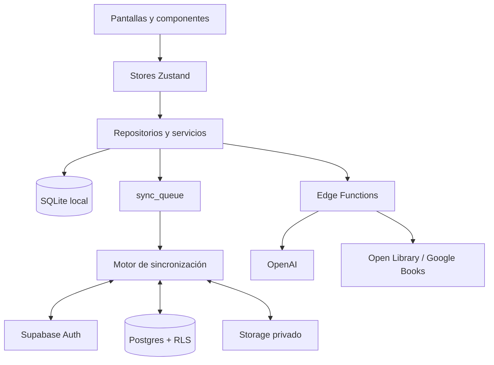

<div align="center">

# 📚 Bookshelf

**Tu biblioteca personal en el bolsillo: organiza tus libros, sigue tu lectura y deja que un «librero» con IA te recomiende el siguiente.**


</div>

## Contenido

1. [Descargar la app](#descargar-la-app)
2. [Qué es Bookshelf](#qué-es-bookshelf)
3. [Funcionalidades](#funcionalidades)
4. [Capturas de pantalla](#capturas-de-pantalla)
5. [Stack tecnológico](#stack-tecnológico)
6. [Arquitectura](#arquitectura)
7. [Seguridad](#seguridad)
8. [Estructura del proyecto](#estructura-del-proyecto)
9. [Ejecutar desde el código](#ejecutar-desde-el-código)
10. [Configurar Supabase](#configurar-supabase)
11. [Generar el APK con EAS](#generar-el-apk-con-eas)
12. [Pruebas y calidad](#pruebas-y-calidad)
13. [Limitaciones conocidas](#limitaciones-conocidas)
14. [Autoría y contexto del curso](#autoría-y-contexto-del-curso)

---

## Descargar la app

<div align="center">

### ⬇️ [**Descargar Bookshelf para Android (APK v1.0.0)**](https://github.com/Juls2212/Bookshelf/releases/tag/v1.0.0)

</div>

**Instalación en Android**

1. Abre el enlace de arriba desde el teléfono y descarga el archivo `.apk`.
2. Cuando Android lo pida, permite **«instalar apps desconocidas»** para el navegador o el
   administrador de archivos que usaste.
3. Abre el APK descargado y pulsa **Instalar**.
4. Abre Bookshelf y **crea una cuenta** con correo y contraseña.

**Qué debes saber**

- La app es **solo para Android** y se distribuye como _preview build_ (APK de distribución
  interna), no desde Google Play.
- Necesitas **conexión a internet** para el primer inicio de sesión y para las funciones de IA
  (escáner, sugerencias y librero). El resto de la app funciona **sin conexión** y se sincroniza
  cuando vuelve la red.

---

## Qué es Bookshelf

Quien lee con frecuencia suele perder la pista de lo que tiene, lo que está leyendo, lo que
prestó y qué leer después. Las hojas de cálculo son incómodas y las apps de lectura sociales
piden más de lo necesario.

Bookshelf es para **lectores que quieren un estante personal y privado**: registras tus libros
(incluso con una foto), ves tu progreso, controlas los préstamos y recibes recomendaciones basadas
en tu propio estante. Todo funciona sin conexión y se sincroniza con tu cuenta.

**Fuera del alcance a propósito:** red social, tienda o enlaces de compra, lector de libros
electrónicos, escaneo de una estantería completa, gamificación y estadísticas avanzadas.

---

## Funcionalidades

**Biblioteca y estados**

- Estante en cuadrícula con búsqueda sin acentos ni mayúsculas y filtros por estado, prestados y
  género.
- Tres estados: **Por leer**, **Leyendo** y **Leído**.
- Alta, edición y borrado de libros con validación de campos.

**Seguimiento de lectura**

- Progreso con **marcador arrastrable** para la página actual.
- **Valoración con estrellas solo en libros leídos**, más notas por libro.
- **Préstamos**: a quién se lo prestaste y filtro de prestados.

**Portadas**

- Foto con la **cámara** o desde la galería, con **recorte**.
- «Mejorar portada»: **corrección de perspectiva** (esquinas ajustables) y niveles, con vista
  Original/Mejorada.
- **Portadas sugeridas** desde Open Library y Google Books, que puedes aceptar o descartar.
- Portada tipográfica cuando el libro no tiene imagen.

**Inteligencia artificial** (siempre revisable antes de guardar)

- **Identificar un libro desde una foto** de la portada o el lomo, con pantalla «Revisa tu libro»
  editable.
- **Autocompletar datos** (autor, género, páginas y título oficial cuando hay certeza).
- **Librero**: una recomendación de tu propio estante con el motivo, filtros de tiempo y ánimo,
  «Leer después», «Otra recomendación» e historial.
- **Nuevas aventuras**: sugiere libros que aún no tienes.

**Estadísticas y perfil**

- Estadísticas de lectura diaria: **Hoy, Esta semana, Este año y Total**.
- Foto de perfil (cámara o galería, recorte cuadrado), nombre y preferencias de lectura.
- Tema **claro y oscuro**.

**Offline-first**

- Cada usuario tiene su base SQLite local; cada cambio se guarda al instante y se sincroniza con
  Supabase cuando hay red. La insignia de sincronización muestra el estado y los cambios
  pendientes.

---

## Capturas de pantalla

<!--
  Aún no existe la carpeta docs/screenshots/.
  Crea la carpeta, copia allí las capturas (por ejemplo inicio.png, biblioteca.png, ficha.png,
  escaner.png, librero.png, perfil.png) y añade aquí, una por línea:
  
-->

_Próximamente: las capturas se añadirán en `docs/screenshots/`._

---

## Stack tecnológico

| Grupo                 | Tecnologías                                                                                           |
| --------------------- | ----------------------------------------------------------------------------------------------------- |
| App                   | React Native 0.86, Expo SDK 57, TypeScript estricto, Expo Router, Reanimated 4, Gesture Handler, Lucide |
| Estado y datos        | Zustand, expo-sqlite (base local por usuario), expo-secure-store (sesión), NetInfo                    |
| Backend               | Supabase: Auth, Postgres con RLS, Storage privado, Edge Functions (Deno)                              |
| IA y APIs externas    | OpenAI (`gpt-4o-mini`) solo desde Edge Functions; Open Library y Google Books para portadas           |
| Imágenes              | expo-camera, expo-image-picker, expo-image-manipulator, expo-image, `@shopify/react-native-skia`      |
| Calidad y entrega     | Jest + Testing Library, ESLint, Prettier, `scripts/checkSecrets.mjs`, EAS Build                       |

---

## Arquitectura

La interfaz nunca habla con Supabase ni con SQLite directamente: usa **repositorios y servicios**
con interfaz. Las escrituras van siempre a la base local y a una cola de sincronización.



- **Local-first:** la app funciona sin red y cada cambio queda en `sync_queue`.
- **Conflictos:** gana la última escritura (_last-write-wins_).
- **Registro de lectura:** cada cambio de página añade una fila en `reading_events` en la misma
  transacción que el libro; solo se inserta, nunca se edita.
- **Cierre de sesión:** borra de la memoria todo lo del usuario; un cierre limpio también borra su
  base local, portadas y foto de perfil.
- **Idiomas:** el código va en inglés; el texto visible, en español neutro (`src/i18n/es.ts`).

---

## Seguridad

- **Sin secretos en la app:** solo viajan `EXPO_PUBLIC_SUPABASE_URL` y
  `EXPO_PUBLIC_SUPABASE_PUBLISHABLE_KEY`, públicas por diseño.
- **OpenAI solo por Edge Functions:** la clave es un secreto de Supabase y nunca llega al
  teléfono.
- **RLS en todas las tablas** por `auth.uid()`; la tabla `ai_usage` no es accesible para los
  usuarios.
- **Storage privado** (`book-covers` y `avatars`), con carpetas por usuario y **URLs firmadas**.
- **Límites de uso por usuario** en cada función de IA (por hora y por día).
- **Límites de entrada** definidos una sola vez en `src/lib/inputLimits.ts`, aplicados en la app,
  en las Edge Functions y en restricciones CHECK de la base de datos; una prueba comprueba que
  coinciden.
- `npm run verify` falla si aparece una clave secreta en el repositorio.

---

## Estructura del proyecto

```text
src/
  app/          Rutas de Expo Router (delgadas): (auth), (tabs), book, scan, dev-gallery
  components/   Componentes de interfaz reutilizables
  design/       Tokens de color y tipografía, tema, iconos, movimiento, contraste
  features/     auth, library, scan, suggestions, recommendations, librarian,
                preferences, profile, sync
  db/           Esquema SQLite, migraciones locales y cola de sincronización
  lib/          Supabase, entorno, red, fechas, límites y saneado de entradas
  stores/       Stores de Zustand
  i18n/         es.ts (todo el texto visible)
  dev/          Galería y servicios de prueba (solo desarrollo)
  test-utils/   Ayudas para las pruebas
  types/        Tipos compartidos
  __tests__/    Pruebas de Jest
supabase/
  migrations/   SQL en orden (se ejecuta a mano)
  functions/    Edge Functions y lógica compartida (_shared)
  tests/        rls_isolation.sql, constraints.sql
scripts/        checkSecrets.mjs, generateAssets.mjs
docs/           supabase-setup.md, ai-setup.md, qa-checklist.md, references/
assets/         Iconos y splash provisionales
```

---

## Ejecutar desde el código

**Requisitos:** Node.js 20 o superior (probado con 22), npm, un proyecto de Supabase y, para la
IA, una clave de OpenAI (se guarda solo en Supabase).

```sh
npm install
```

En **Windows**, si la instalación falla en el script de `@shopify/react-native-skia`, usa
`npm install --ignore-scripts`. Es un atajo **solo para instalaciones locales en Windows**.

**Variables de entorno:** copia `.env.example` como `.env` y completa estas dos (los valores son
tuyos; nunca los subas al repositorio):

```text
EXPO_PUBLIC_SUPABASE_URL
EXPO_PUBLIC_SUPABASE_PUBLISHABLE_KEY
```

Después inicia el servidor de desarrollo:

```sh
npx expo start -c
```

**Limitaciones de Expo Go:** sirve para probar la interfaz y las funciones con red, pero **no
permite probar el modo sin conexión**. Para eso instala el APK. Si la red bloquea el código QR,
usa `npx expo start --tunnel`. En desarrollo, **Perfil → Galería de componentes** ofrece servicios
de prueba (escáner, sugerencias, librero) sin gastar IA; no existe en el APK.

---

## Configurar Supabase

Guía completa en [`docs/supabase-setup.md`](docs/supabase-setup.md).

**1. Migraciones**, en este orden (SQL Editor → New query → Run):

| #   | Archivo                                                          |
| --- | ---------------------------------------------------------------- |
| 1   | `supabase/migrations/20261010000000_initial_schema.sql`          |
| 2   | `supabase/migrations/20261010000100_storage_covers.sql`          |
| 3   | `supabase/migrations/20261011000000_ai_usage.sql`                |
| 4   | `supabase/migrations/20261012000000_discovery_recommendations.sql` |
| 5   | `supabase/migrations/20261013000000_profile_avatars.sql`         |
| 6   | `supabase/migrations/20261014000000_reading_events.sql`          |
| 7   | `supabase/migrations/20261015000000_input_constraints.sql`       |

**2. Auth:** en **Authentication → Sign In / Providers → Email**, **desactiva «Confirm email»**.
La app no tiene paso de código de verificación: al registrarse entra directo.

**3. Edge Functions** (las cinco):

```sh
npx supabase login
npx supabase link --project-ref <ref-del-proyecto>
npx supabase functions deploy identify-book
npx supabase functions deploy suggest-book-details
npx supabase functions deploy recommend-book
npx supabase functions deploy discover-book
npx supabase functions deploy find-cover
```

No uses `--no-verify-jwt`.

**4. Secretos de las funciones:**

```sh
npx supabase secrets set OPENAI_API_KEY=<tu-clave> OPENAI_MODEL=gpt-4o-mini
npx supabase secrets set GOOGLE_BOOKS_API_KEY=<tu-clave-de-google-books>   # opcional
```

> ⚠️ **Estos secretos se guardan únicamente en Supabase.** Nunca los pongas en `.env`,
> `app.json`, `src/` ni en ningún archivo del repositorio.

Más detalles de las funciones, límites y errores en [`docs/ai-setup.md`](docs/ai-setup.md).

---

## Generar el APK con EAS

`eas.json` define tres perfiles: `development` (cliente de desarrollo), `preview` (APK de
distribución interna) y `production` (App Bundle).

```sh
npx eas-cli@latest login
npx eas-cli@latest init
npx eas-cli@latest env:create --environment preview --name EXPO_PUBLIC_SUPABASE_URL --value https://tu-proyecto.supabase.co --visibility plaintext
npx eas-cli@latest env:create --environment preview --name EXPO_PUBLIC_SUPABASE_PUBLISHABLE_KEY --value <clave-publicable> --visibility plaintext
npx eas-cli@latest build --platform android --profile preview
```

- El `.env` local **no se sube** a EAS; por eso las dos variables públicas se crean como variables
  de entorno de EAS. No crees allí ninguna clave secreta.
- Al terminar, EAS entrega un enlace y un QR para descargar el APK.
- **Alternativa:** compilar desde GitHub (conectando el repositorio al proyecto de EAS) y publicar
  el APK resultante como _release_, como en el enlace de [Descargar la app](#descargar-la-app).

---

## Pruebas y calidad

```sh
npm run verify
```

Ejecuta, en orden: `typecheck` (TypeScript), `lint` (ESLint sin avisos), `format:check`
(Prettier), `test` (Jest) y `check:secrets` (busca claves secretas sin leer `.env`).

- Pruebas automáticas en `src/__tests__/` (lógica, repositorios, sincronización, pantallas y
  Edge Functions).
- Lista de pruebas manuales en dispositivo: [`docs/qa-checklist.md`](docs/qa-checklist.md).
- Pruebas de SQL en [`supabase/tests/`](supabase/tests): `rls_isolation.sql` (aislamiento por
  usuario) y `constraints.sql` (límites de entrada). Terminan con `ROLLBACK`, no guardan nada.

---

## Limitaciones conocidas

- **Recuperar la contraseña** solo envía el correo de Supabase; la app todavía no completa el
  cambio.
- **Sincronización «gana la última escritura»:** si editas el mismo libro en dos dispositivos sin
  conexión, prevalece la última edición sincronizada.
- Si una **portada se cambia en otro dispositivo**, este puede seguir mostrando la copia local
  anterior.
- **La IA puede equivocarse:** todo se revisa antes de guardar y los libros sugeridos pueden no
  existir (se marcan como «no comprobados»).
- Los **límites de uso** cuentan también los intentos fallidos.
- `npm audit --omit=dev` reporta vulnerabilidades en **herramientas de compilación** de Expo y
  Jest; arreglarlas exige versiones incompatibles con SDK 57, por eso no se aplicó `--force`.
- Cámara, Skia, modo avión, permisos y lectores de pantalla **solo se prueban en un dispositivo
  real**, sin pruebas automáticas.
- El icono, el icono adaptable y la splash son **provisionales** (`scripts/generateAssets.mjs`).

---

## Autoría y contexto del curso

Proyecto final de la asignatura **Diseño de Interfaces** (5.º semestre).

<!--
  Añade aquí los nombres del equipo, la institución, el docente y la fecha de entrega.
  El README anterior no incluía esa información y no se inventó.
-->
